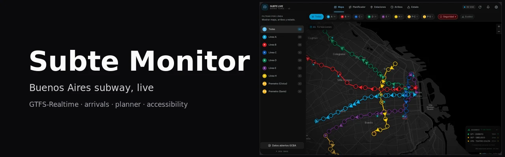
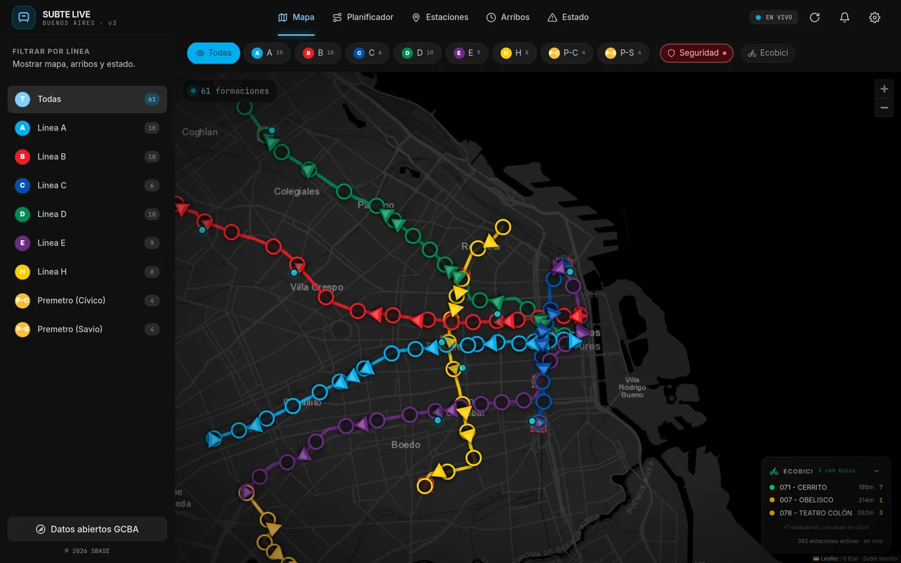
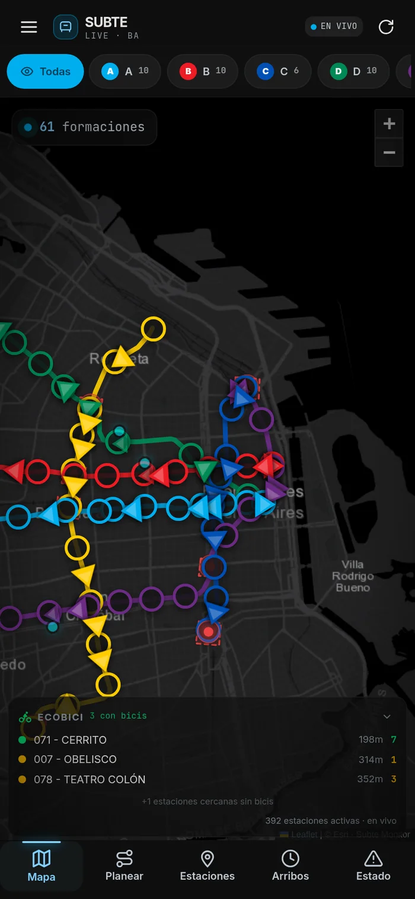

<p align="center">
  
</p>

<h1 align="center">Subte Monitor</h1>

<p align="center">
  Live map of the Buenos Aires subway and Premetro.<br>
  Reads the official GTFS-Realtime feed, turns vehicle predictions into train positions,<br>
  and serves arrivals, service alerts, accessibility data and a step-free route planner.
</p>

<p align="center">
  <a href="https://subte-monitor.vercel.app"><b>Live app</b></a> ·
  <a href="docs/ARCHITECTURE.md">Architecture</a> ·
  <a href="CONTRIBUTING.md">Contributing</a>
</p>

<p align="center">
  <a href="https://github.com/Juan-Martin-Cerezo/subte-monitor/actions/workflows/ci.yml"></a>
  
  
  
</p>

<table>
  <tr>
    <td width="72%"></td>
    <td width="28%"></td>
  </tr>
  <tr>
    <td align="center"><sub>Desktop: live map, line filters and Ecobici availability</sub></td>
    <td align="center"><sub>Mobile: same screens with bottom navigation</sub></td>
  </tr>
</table>

## What it does

Six screens, one dashboard, all driven by the same live feed:

| Screen       | What it shows                                                                                                             |
| ------------ | ------------------------------------------------------------------------------------------------------------------------- |
| **Map**      | Every active train positioned along its line, coloured per line and oriented by direction. Line filters and a follow pin. |
| **Arrivals** | Next trains per station and line, with the time to arrival calculated from the realtime feed.                             |
| **Status**   | Official GCBA service alerts plus reports submitted by users.                                                             |
| **Stations** | The network station by station, including lifts, escalators and accessibility data.                                       |
| **Planner**  | Fastest route between two stations, with a step-free mode that penalises transfers without accessible access.             |
| **Ecobici**  | Docks with bikes available near the visible map area, from the city GBFS feed.                                            |

The feed covers lines A, B, C, D, E and H plus both Premetro branches (Cívico and Savio).

## Stack

| Layer    | Technology                                                                            |
| -------- | ------------------------------------------------------------------------------------- |
| Frontend | Next.js 16 (App Router), React 19, Tailwind CSS 4                                     |
| Map      | Leaflet with dark raster tiles and GTFS shapes                                        |
| Data     | GTFS static (stations and sequences) + GTFS-Realtime (vehicle predictions and alerts) |
| Database | PostgreSQL via Prisma 6 (Neon, Supabase, Docker or local)                             |
| Deploy   | Any Node host; the reference deploy runs on Vercel                                    |

## Quick start

Requirements: Node 20 or newer, a PostgreSQL database, and a GCBA transport API key ([request one here](https://apitransporte.buenosaires.gob.ar/)).

```bash
git clone https://github.com/Juan-Martin-Cerezo/subte-monitor.git
cd subte-monitor
npm install
cp .env.example .env.local     # DATABASE_URL, SUBTE_CLIENT_ID, SUBTE_CLIENT_SECRET
npm run db:push                # create the tables
npm run db:seed                # load stations and stop sequences
npm run dev                    # http://localhost:3000
```

`npm install` runs `prisma generate` automatically. The seed reads the committed `gtfs.zip`, so it works offline; if the file is missing it downloads the current feed with your credentials.

## Environment variables

| Variable              | Required | Purpose                                                                                                                                    |
| --------------------- | -------- | ------------------------------------------------------------------------------------------------------------------------------------------ |
| `DATABASE_URL`        | yes      | PostgreSQL connection string. Neon's HTTP driver is used when the host contains `neon.tech`; any other server uses Prisma's standard pool. |
| `SUBTE_CLIENT_ID`     | yes      | Client id for the GCBA transport API.                                                                                                      |
| `SUBTE_CLIENT_SECRET` | yes      | Client secret for the GCBA transport API.                                                                                                  |

The app starts without credentials, but `/api/telemetry` returns an explicit error until they are set. There are no defaults baked into the code.

## API

| Endpoint                 | Description                                                                                     |
| ------------------------ | ----------------------------------------------------------------------------------------------- |
| `GET /api/bootstrap`     | Stations and route sequences, fetched once when the dashboard loads.                            |
| `GET /api/telemetry`     | Processed train positions, arrivals and service alerts. Polled every two seconds by the client. |
| `GET /api/reports?line=` | Latest user reports, optionally filtered by line.                                               |
| `POST /api/reports`      | Creates a report with `line`, `station`, `category` and `comment`.                              |
| `GET /api/ecobici`       | Nearby bike docks with availability, cached for 60 seconds.                                     |

## How the telemetry works

The GCBA feed publishes arrival predictions, not vehicle positions. The server reconstructs positions:

1. Fetch `forecastGTFS` and `serviceAlerts` with the API key.
2. Group predictions by trip and cluster the predicted times, so a single train is not counted once per downstream station.
3. Derive a stable id per train from its route, direction and trip start time, so the same train keeps its marker between polls.
4. Interpolate the position along the line's GTFS shape using the predicted time for the next stop.
5. Cache the processed result for 1.5 seconds and fall back to the last known good payload when the upstream feed fails, so the map does not go blank.

The details, including the clustering and interpolation functions, are in [`docs/ARCHITECTURE.md`](docs/ARCHITECTURE.md).

## Anden

Anden is the assistant layer of this app. It answers questions about the Buenos Aires subway from the same data the map shows: official alerts, upcoming trains, trip routes, station access and a written knowledge base. A hand-written harness plans each question, calls a small set of tools, enforces a per-question budget and stores every step as a trace. It runs locally without a database.

Three questions it answers:

- ¿Está andando la línea B ahora?
- ¿Hasta qué hora funciona el subte?
- ¿Cuánto sale el boleto de subte?

The MCP server is a separate package: [packages/subte-mcp](packages/subte-mcp/README.md). Architecture, the five stages, the measured limits and the local commands: [docs/anden.md](docs/anden.md).

<!-- evals:start -->

### Anden evals

Generated by `npm run evals` on 2026-10-30. 50 cases against the live model. Each row is a hand-written case; the detail per case is in `evals/results/latest.json`.

| Set                | Cases | tool acc | arg acc | citation validity | abstain | hallucination | p50 ms | p95 ms | tokens | cost USD |
| ------------------ | ----: | -------: | ------: | ----------------: | ------: | ------------: | -----: | -----: | -----: | -------: |
| all                |    50 |     100% |    100% |              100% |    100% |            0% |   2532 |   3994 | 143149 |   0.0425 |
| tool_selection     |    15 |     100% |    100% |               n/a |    100% |            0% |   2683 |   4667 |  41217 |   0.0123 |
| trip_planning      |    10 |     100% |    100% |               n/a |    100% |            0% |   2608 |   2927 |  28536 |   0.0087 |
| retrieval_citation |    10 |      n/a |     n/a |              100% |    100% |            0% |   2416 |   2763 |  33467 |   0.0100 |
| abstain            |    10 |      n/a |     n/a |               n/a |    100% |            0% |   2088 |   3994 |  25000 |   0.0071 |
| memory             |     5 |     100% |     n/a |               n/a |    100% |            0% |   2514 |   2892 |  14929 |   0.0045 |

Thresholds used by CI: `hallucination_rate <= 0.10` and `tool_accuracy >= 0.85`.
<!-- evals:end -->

The scorers are themselves covered by `npm run anden:evals-selfcheck`, so a perfect run means the checks fire, not that they are inert. It plants a clean answer, an invented station, an invented fare, a contradictory timetable and an unresolved citation and fails when any scorer stays silent.

## Project layout

```
prisma/               schema, seed and GTFS parsing
src/app/              routes, layout and API endpoints
src/app/api/          bootstrap, telemetry, reports and ecobici
src/components/       dashboard shell and the five screens
src/lib/              telemetry engine, planner graph, GBFS client and static data
scripts/              generators for the static datasets
docs/                 architecture and screenshots
```

## Deploy

1. Create a PostgreSQL database and run `npm run db:push && npm run db:seed` once.
2. Import the repository into your host and set `DATABASE_URL`, `SUBTE_CLIENT_ID` and `SUBTE_CLIENT_SECRET`.
3. Deploy. The dashboard is dynamic, so nothing needs to be rebuilt when the feed changes.

## Data sources and attribution

- **GTFS and GTFS-Realtime**: Gobierno de la Ciudad de Buenos Aires, via [apitransporte.buenosaires.gob.ar](https://apitransporte.buenosaires.gob.ar/). Service data belongs to SBASE and the City.
- **Ecobici**: GBFS v3 feed from `buenosaires.publicbikesystem.net`.
- **Basemap**: Esri raster tiles, attributed inside the map.
- **Static network data**: compiled from the City's open data portal and the official GTFS, stored under `src/lib/`.

The repository does not redistribute the live feed; it queries it with the operator's own key.

## Known limitations

- There are no automated tests yet. The telemetry engine is the first place that deserves them.
- The GCBA key is rate limited per account. Heavy polling against the same key will be throttled by the provider, not by the app.
- Arrival clustering is heuristic: during disruptions the reconstructed positions can lag a few minutes behind the official information.
- `POST /api/reports` has no authentication or rate limiting. Add both before running a public instance at scale.

## Contributing

Issues and pull requests are welcome. Read [`CONTRIBUTING.md`](CONTRIBUTING.md) and run `npm run format:check`, `npm run lint`, `npm run typecheck` and `npm run build` before opening a pull request.

Ideas that would help:

- Tests for the clustering, interpolation and planner logic.
- Swap the generated connection data for a build step that downloads it.
- Show planned service changes separately from realtime alerts.
- Keyboard navigation and screen reader labels on the map.

## License

MIT. See [`LICENSE`](LICENSE).
