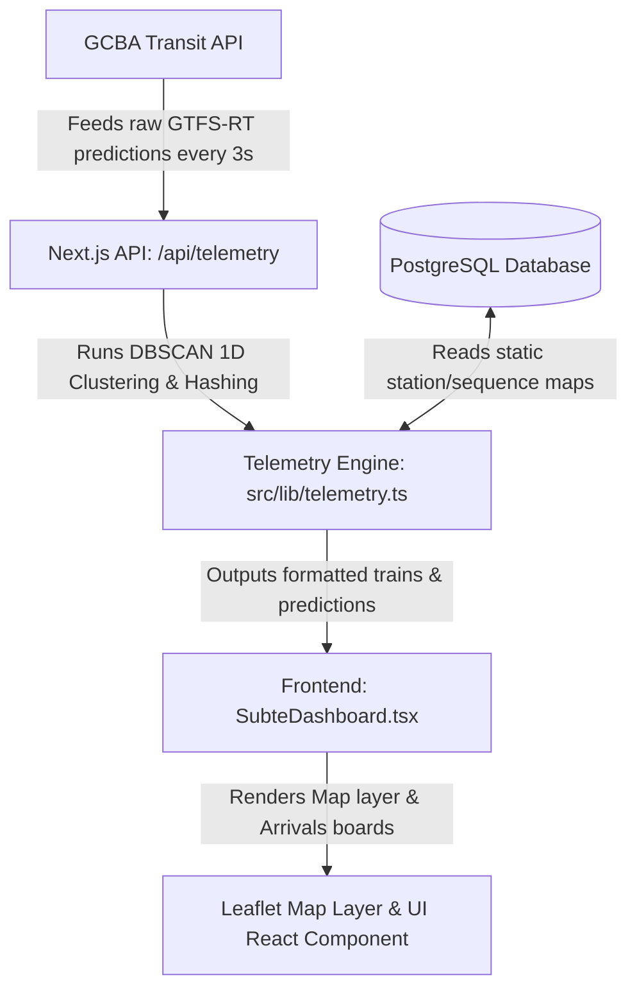

# Subte Monitor Deep Documentation Directory

Welcome to the comprehensive, line-by-line documentation for the `subte-monitor` project. This guide is specifically designed so that anyone—even those with absolutely no programming experience—can understand, modify, run, and build features from scratch on this platform.

Every aspect of the system, from database models to front-end map interactions and real-time stateful tracking, is fully documented. Below is the directory of all guides available in the `docs/` folder:

---

## Documentation Files Index

### [1. General Architecture Overview](file:///home/juan/Escritorio/Programacion/subte-monitor/docs/01_architecture_overview.md)
*   **Purpose**: Explains how data flows from the Buenos Aires City Government's Transit API, through our Next.js backend server, into our database, and finally up to the client web browser.
*   **Scope**: Conceptual model of the network, data-lifecycle, and technology stack.

### [2. Programming Guide for Absolute Beginners](file:///home/juan/Escritorio/Programacion/subte-monitor/docs/02_beginner_programming_guide.md)
*   **Purpose**: Introduces basic web concepts (React, Next.js, HTML/CSS, TypeScript, database models) and provides a step-by-step tutorial on how to add a simple feature from scratch.
*   **Scope**: Syntactical basics, file structure, hooks, React props, and coding tips.

### [3. Database Models & Schema Guide](file:///home/juan/Escritorio/Programacion/subte-monitor/docs/03_database_and_prisma.md)
*   **Purpose**: Explains how our PostgreSQL database is structured, how to modify models in Prisma, how to generate migrations, and how the GTFS seed script works.
*   **Scope**: Prisma schema file breakdown, database commands, and migration flows.

### [4. Telemetry and Stateful Tracking Engine](file:///home/juan/Escritorio/Programacion/subte-monitor/docs/04_telemetry_engine_details.md)
*   **Purpose**: Details the mathematical logic used to cluster station predictions into physical trains, hash stable IDs, interpolate movements, and prevent "teleportation" using the Holding-at-the-Signal logic.
*   **Scope**: DBSCAN 1D clustering, interpolation formula, time synchronization offset, and cache mechanisms.

### [5. Frontend Leaflet Map & Stitch UI Guide](file:///home/juan/Escritorio/Programacion/subte-monitor/docs/05_frontend_and_map.md)
*   **Purpose**: Outlines how the Leaflet map is rendered, how layers (tracks, stations, train markers) are updated dynamically, how mobile line filters work, and how screens are structured.
*   **Scope**: React components, Leaflet hooks, tab routing, CSS filters for dark mode map.

### [6. Local Running, Deployment, & Production Operations](file:///home/juan/Escritorio/Programacion/subte-monitor/docs/06_deployment_and_operations.md)
*   **Purpose**: Step-by-step checklist on how to run the project locally, configure environment variables, deploy to Vercel, and sync production databases.
*   **Scope**: Command scripts, Vercel deployments, environment keys, and troubleshooting.

---

## Core Operational Flow

The following diagram illustrates how the system operates at a high level:

