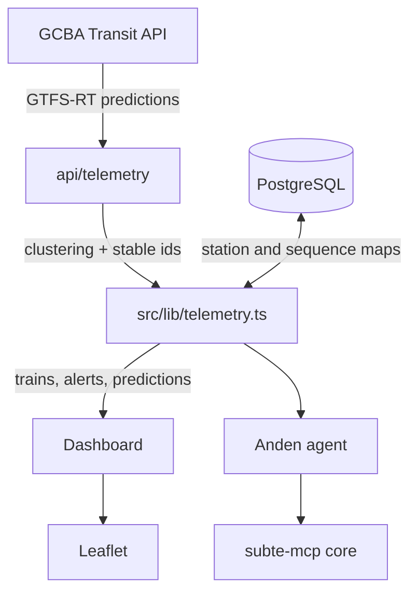

# Docs

Reference material for the parts of this codebase that are not obvious from the code.

| # | Document | What it covers |
|---|----------|----------------|
| 1 | [Architecture overview](01_architecture_overview.md) | How data moves from the GCBA feed to the browser |
| 2 | [Database and Prisma](03_database_and_prisma.md) | Schema, migrations, GTFS seed |
| 3 | [Telemetry engine](04_telemetry_engine_details.md) | 1D clustering, stable ids, interpolation |
| 4 | [Frontend and map](05_frontend_and_map.md) | Leaflet layers, screens, mobile filters |
| 5 | [Deployment and operations](06_deployment_and_operations.md) | Local setup, env vars, Vercel |
| 6 | [Anden, the AI layer](anden.md) | MCP server, retrieval, memory, evals, harness |

## Data flow

